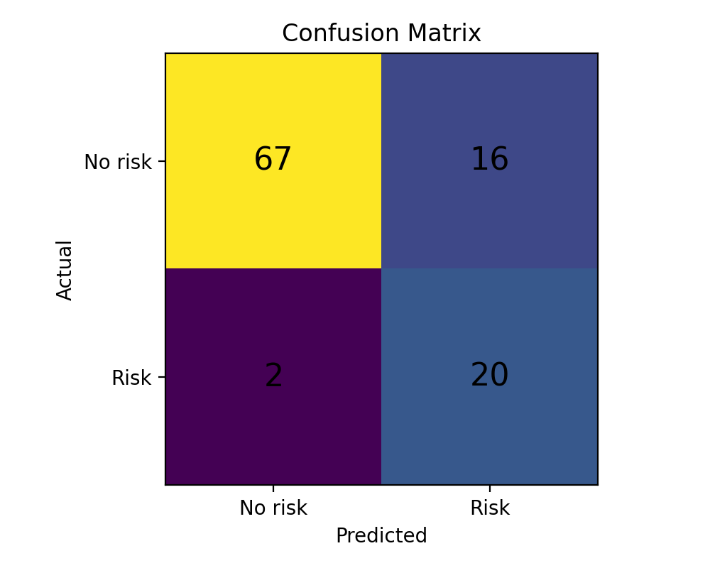
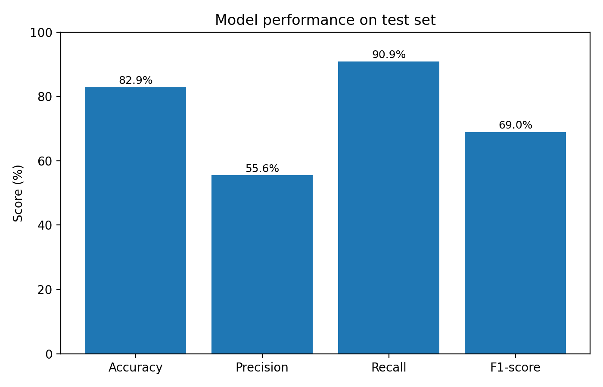
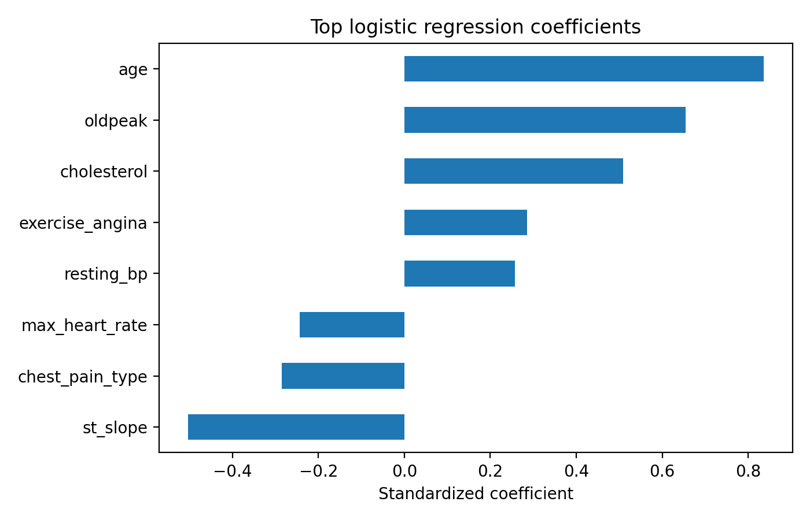

# Heart Attack Risk Classification with Logistic Regression

A Machine Learning course project demonstrating binary classification with Python and scikit-learn. The workflow covers data inspection, a stratified train/test split, feature scaling, logistic regression, and model evaluation.

This is an educational demonstration using a sample dataset, not a clinically validated prediction tool. Predictions refer to the supplied dataset labels and should not be used for medical decisions.

## Dataset

The included `heart_attack_sample.csv` has **420 rows**, **10 input features**, and the binary target `heart_attack_risk`:

- Class 0: 331 rows.
- Class 1: 89 rows.

Inputs are age, sex, chest pain type, resting blood pressure, cholesterol, fasting blood sugar, maximum heart rate, exercise angina, oldpeak, and ST slope. The original materials describe this as a local demonstration dataset; they do not establish its clinical provenance or provide a source URL. Numeric category codes are used as supplied.

## Method

1. Load the dataset and print its shape and missing-value counts.
2. Split into 75% training data and 25% test data, stratified by the target (`random_state=42`).
3. Fit `StandardScaler` and `LogisticRegression` together in a scikit-learn pipeline, keeping preprocessing fitted on training data only.
4. Train with `solver="liblinear"`, `class_weight="balanced"`, and `max_iter=1000`.
5. Evaluate accuracy, precision, recall, F1-score, and the confusion matrix.
6. Print the eight largest coefficients by absolute magnitude and save a confusion matrix chart.

## Quick start

Use Python 3.10 or newer. From the project folder:

```bash
python -m venv .venv
```

Activate on Windows PowerShell:

```powershell
.\.venv\Scripts\Activate.ps1
```

Or on macOS / Linux:

```bash
source .venv/bin/activate
```

Then install dependencies and run:

```bash
python -m pip install -r requirements.txt
python main.py
```

The program prints evaluation results and saves `figures/confusion_matrix_from_code.png`. The dataset and output directory are resolved relative to the script, so it can also be launched from another working directory.

## Reported results

The original course README reports the following results for the included sample dataset:

- **Accuracy:** 0.829
- **Precision:** 0.556
- **Recall:** 0.909
- **F1-score:** 0.690

These are historical project results, not an independently rerun benchmark. They describe one held-out split of the sample data, not clinical performance.





## Model interpretation

The script prints coefficients for scaled features. Their signs and magnitudes describe associations learned by this model; they do not establish medical causation. Categorical codes are currently treated as numeric inputs, which is a limitation of this baseline.



The figures included here are preserved from the original course submission. Running `main.py` regenerates the confusion matrix only.

## Project structure

```text
heart-attack-logistic-regression/
|-- main.py
|-- heart_attack_sample.csv
|-- requirements.txt
|-- figures/
|-- .gitignore
`-- README.md
```

## Limitations and possible improvements

- The sample dataset has no documented clinical provenance in the supplied materials.
- Evaluation uses a single train/test split without cross-validation or confidence intervals.
- Missing values are reported but not imputed.
- Encoded categorical features could be handled explicitly with one-hot encoding.
- Future work could compare baselines, examine precision-recall tradeoffs, and assess probability calibration.

## Technologies

Python, pandas, scikit-learn, and Matplotlib.
